<div align="center">


# SmartWallet

**Track every rupee in seconds. Tap, speak or scan a bill.**

An offline-first money manager for Android. Expenses, budgets, accounts, credit cards and loans, all stored on your phone. No sign-up, no ads, no server.


### [⬇ Download the latest APK](https://github.com/thekirankumarv/SmartWallet-releases/releases/latest)

</div>

<p align="center">
  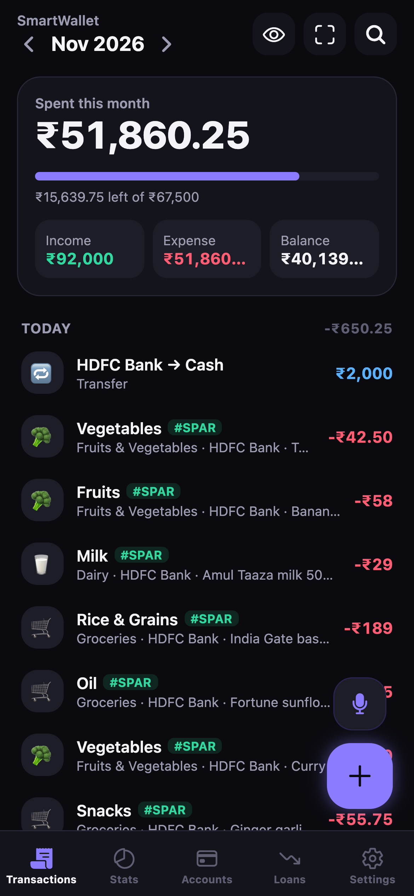
  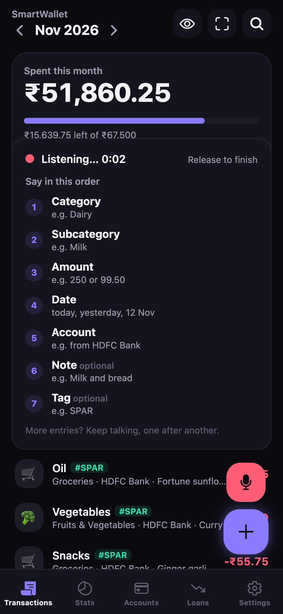
  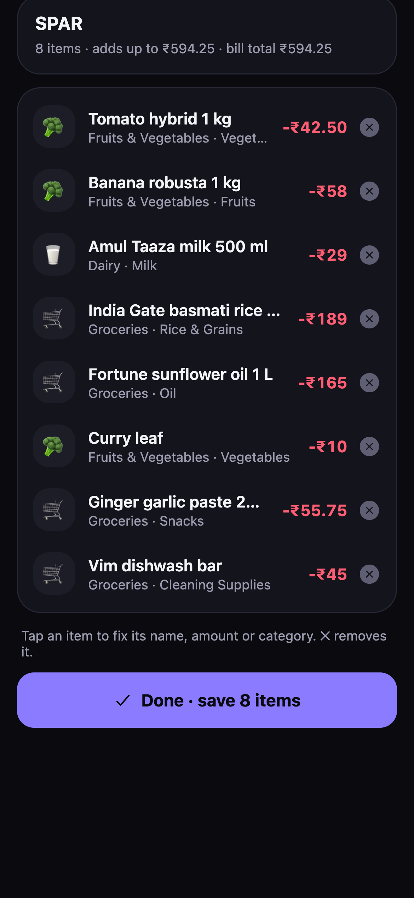
  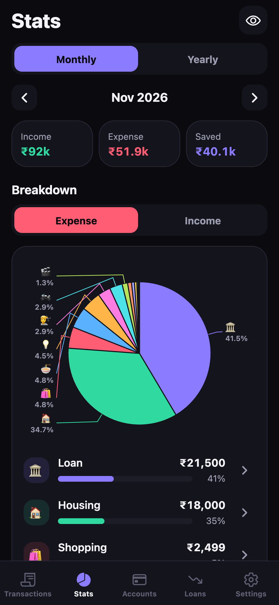
</p>

## Contents

- [Install](#install)
- [Features](#features)
- [Screenshots](#screenshots)
- [Set up voice and bill scanning](#set-up-voice-and-bill-scanning)
- [Privacy](#privacy)
- [Updates](#updates)
- [FAQ](#faq)

## Install

1. Open the [latest release](https://github.com/thekirankumarv/SmartWallet-releases/releases/latest) on your Android phone.
2. Download `SmartWallet-vX.Y.Z.apk` from **Assets**.
3. Open it. If Android asks, allow **Install unknown apps** for your browser or file manager.
4. Open SmartWallet and add your first account.

Needs Android 7.0 or newer on a 64-bit (arm64) phone, which covers almost every phone from the last several years.

## Features

### ✍️ Transactions
- Expense, income and transfer, with a built-in calculator keypad (`40+7`, `2×120`)
- Two taps to categorise: category, then subcategory (**Dairy → Milk**)
- Today / Yesterday chips, or any date and time
- **+ Next** to log several items in a row
- Notes and colour-coded **tags** for shops, trips or festivals (`#SPAR`, `#Goa trip`, `#Diwali`)
- **Hold to peek:** hold any entry to see its details without opening it
- Swipe between months; entries grouped by day with daily totals

### 🎙️ Voice entry
- Hold the mic, speak, let go
- The popup shows what to say and in which order: category, subcategory, amount, date, account, then a note and tag if you like
- Say several entries in one go: *"Dairy, milk, 47, today, from cash. Vehicle, fuel, 205, yesterday, from card"*
- Understands "yesterday", "last Friday", "on the 5th", and matches your own accounts, categories and tags
- You check every entry before it's saved

### 🧾 Bill scanning
- Photograph a supermarket bill, pick one from the gallery, or choose a PDF
- The camera finds the bill's edges and crops it, up to 5 photos for long bills
- The AI reads every line: **each item becomes its own expense** with the right category
- Fix anything, pick the date, account and tag, then save all items in one tap
- **Scanned bills** keeps each bill with its photo and items, and warns when the items don't add up to the bill total

### 📊 Stats & budgets
- Monthly and yearly income, expense and savings
- Pie chart by category; tap one to see its subcategories and which account paid
- Monthly budget per category with progress bars (green → amber → red)
- Month-by-month bars for the year
- Spend per tag; tap a tag to see its transactions

### 🏦 Accounts
- Bank, cash, wallet, credit card, fixed deposit and loan, plus your own types (gold, stocks…)
- Live balances, net worth, and assets vs liabilities
- Transfers between accounts, which never count as spending
- Balance corrections are kept as adjustments, so history is never lost

### 💳 Credit cards
- Limit, outstanding, available credit, utilisation, statement day and due day
- Regular or FD-backed cards
- **Pay bill** is a transfer from your bank, so the bill isn't counted as spending twice
- Spending past the available credit is blocked

### 🏠 Loans
- Outstanding amount, % repaid and expected payoff month
- **Pay EMI** in one tap; interest is added each month automatically (reducing balance)
- Reports show EMI and interest separately

### ⏰ Payment reminders
- Rent, bills, card dues, EMIs, insurance: repeat every few days, weeks, months or years
- Notifications before the due date and on the day
- **Pay** opens a pre-filled entry; saving marks the reminder paid
- Overdue payments show as a banner on the home screen

### 🙈 Hide amounts
- **Eye button** hides every balance and total when someone can see your screen; tap one to peek for 3 seconds
- Option to always start with amounts hidden

### 🔎 Search
- Search notes, categories, accounts, tags and amounts
- Filter by date range, type, account, category and tags

### 💾 Backup & data
- Back up to Google Drive (or anywhere) and restore on a new phone
- Export to CSV for spreadsheets; import CSV from other apps, with duplicate detection
- Every delete asks first

### 🗂️ Categories & tags
- A ready-made set of categories (Dairy, Groceries, Bills & Utilities, Vehicle…)
- Add, rename, hide or delete categories and subcategories
- Tags with your own colours; rename, merge or delete them

### ✨ And more
- **Help & FAQ** built in, with search
- **In-app updates:** a popup when a new version is out, installed in a couple of taps
- **Send feedback** straight from Settings
- Dark theme, haptic feedback, Indian number format (₹1,23,456.78)

## Screenshots

### Transactions
<p>
  
  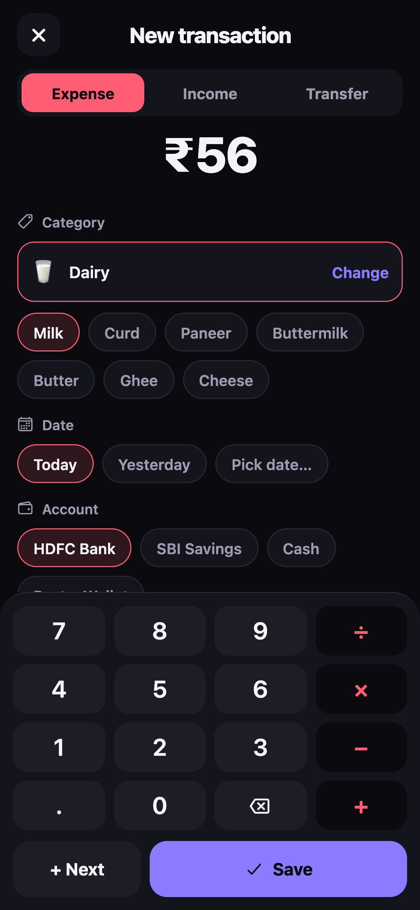
  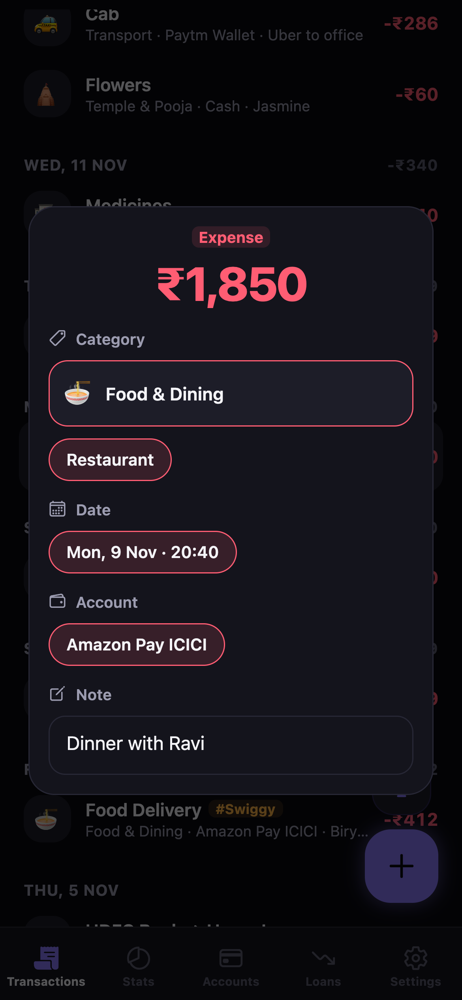
  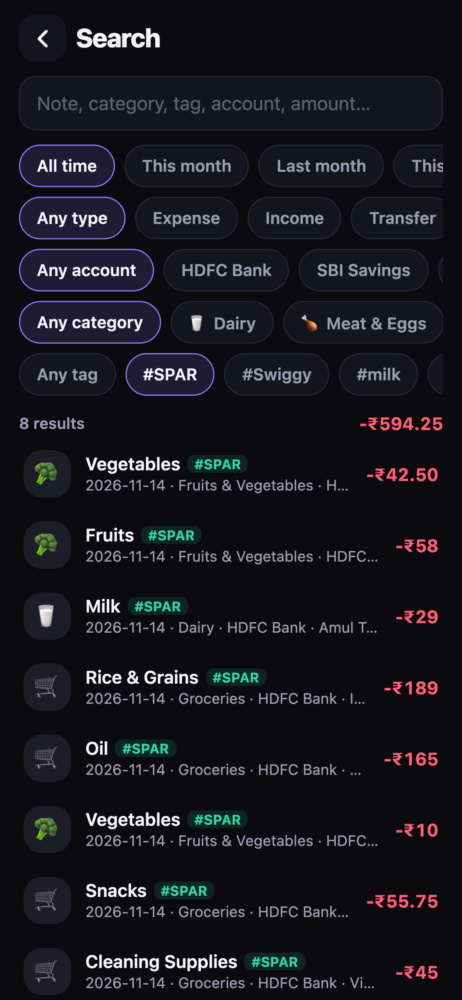
</p>

### Voice entry
<p>
  
  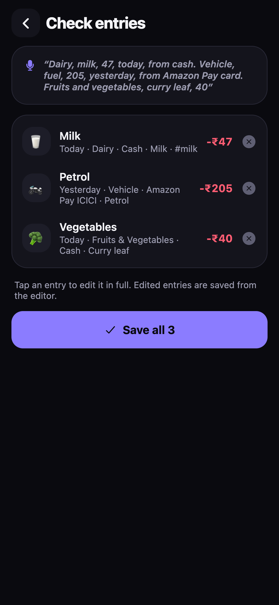
  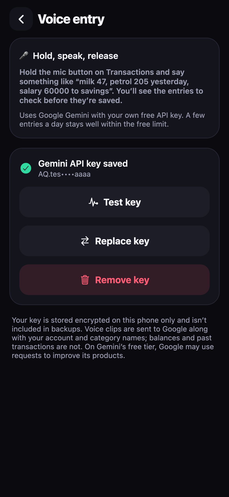
</p>

### Bill scanning
<p>
  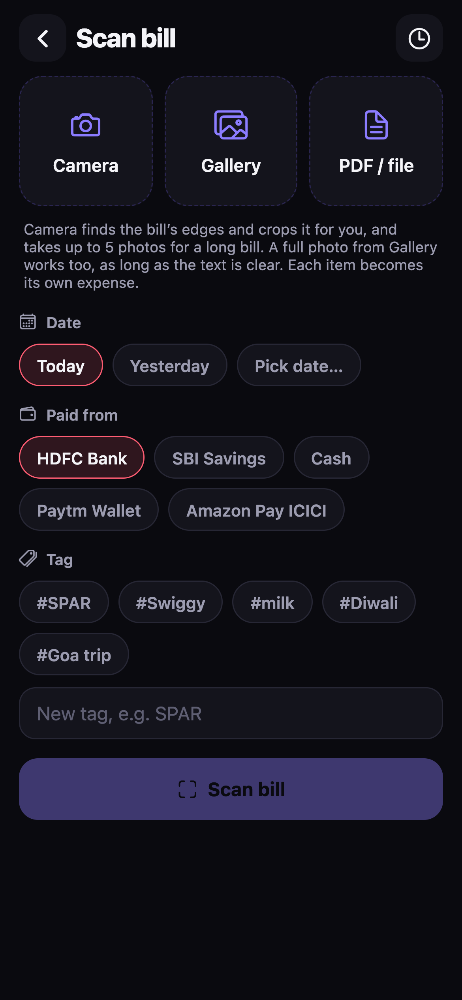
  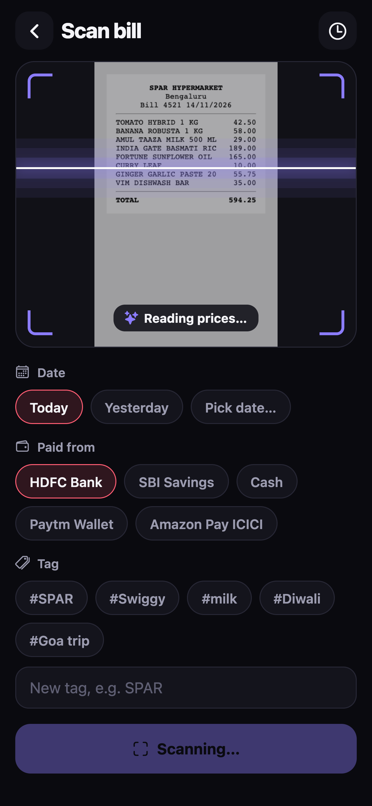
  
  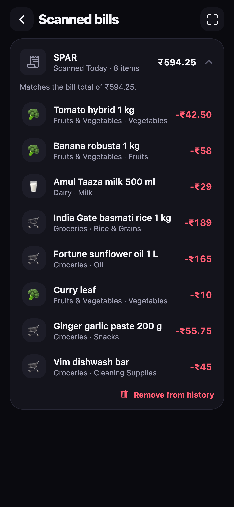
</p>

### Stats & budgets
<p>
  
  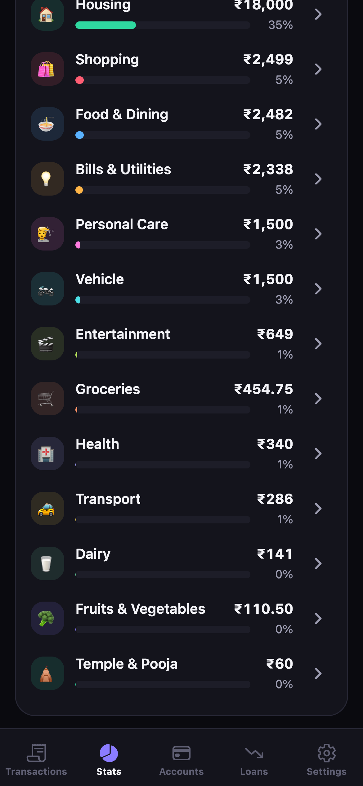
  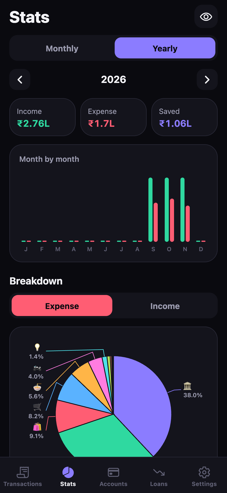
  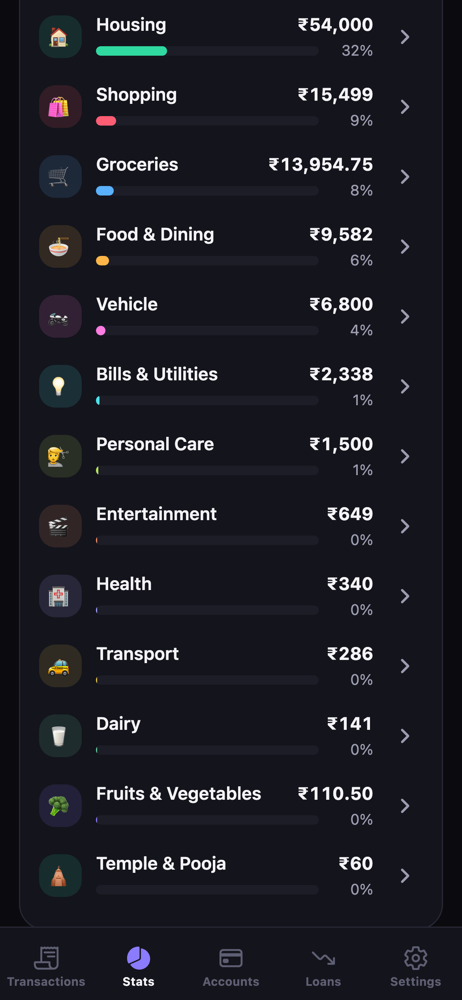
</p>
<p>
  
</p>

### Accounts, cards & loans
<p>
  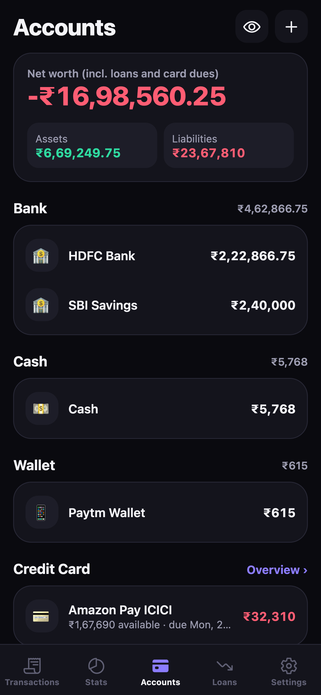
  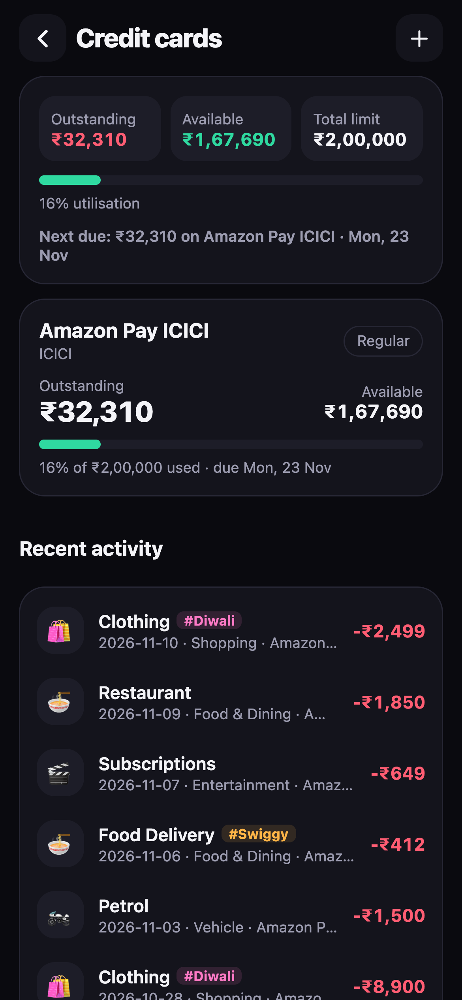
  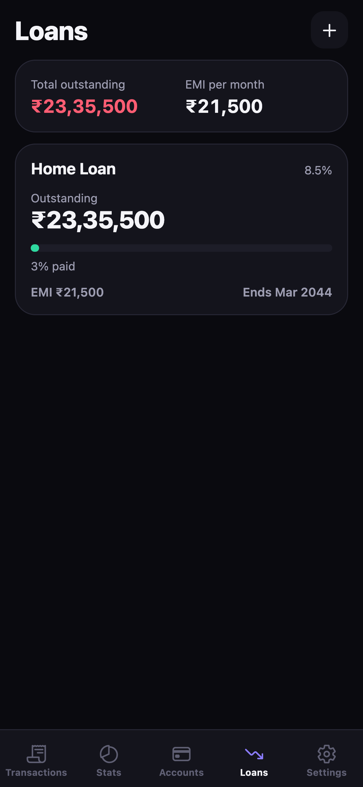
  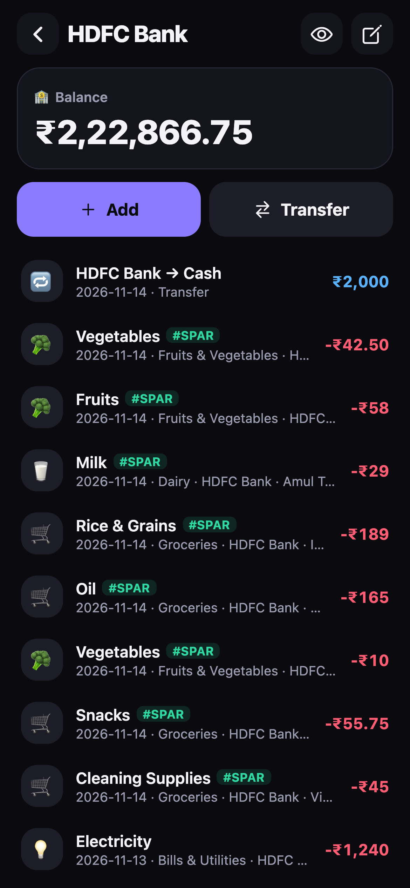
</p>

### Reminders, tags & privacy
<p>
  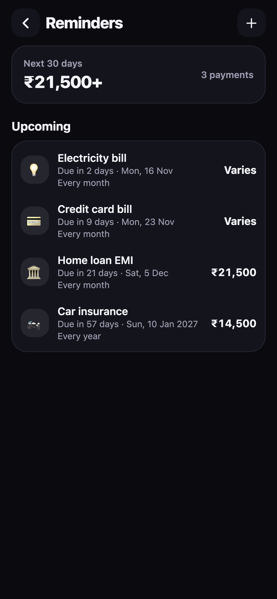
  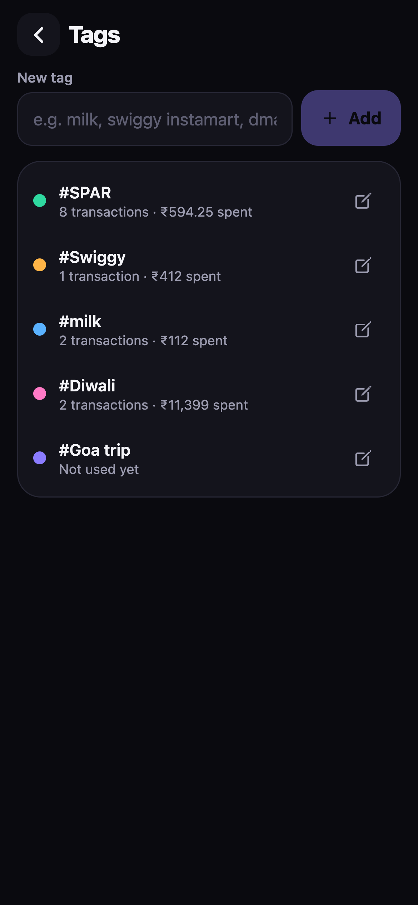
  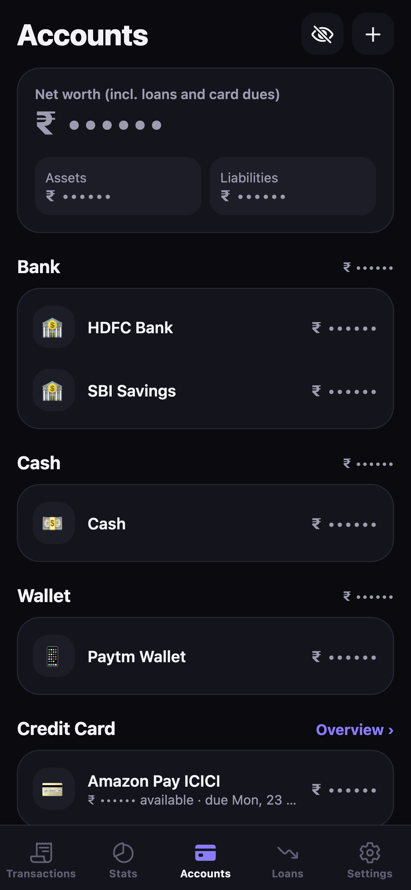
</p>

### Settings, help & updates
<p>
  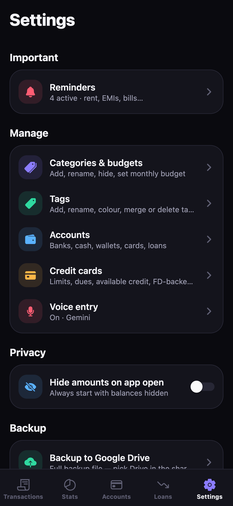
  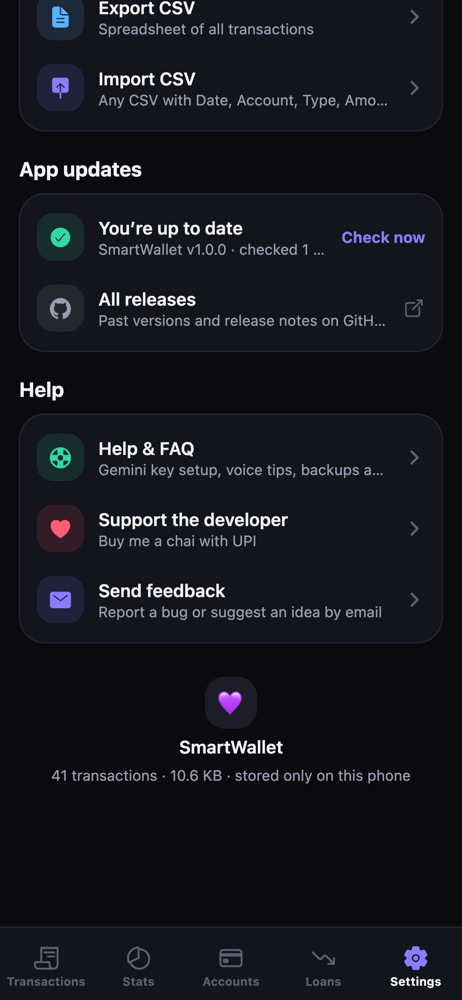
  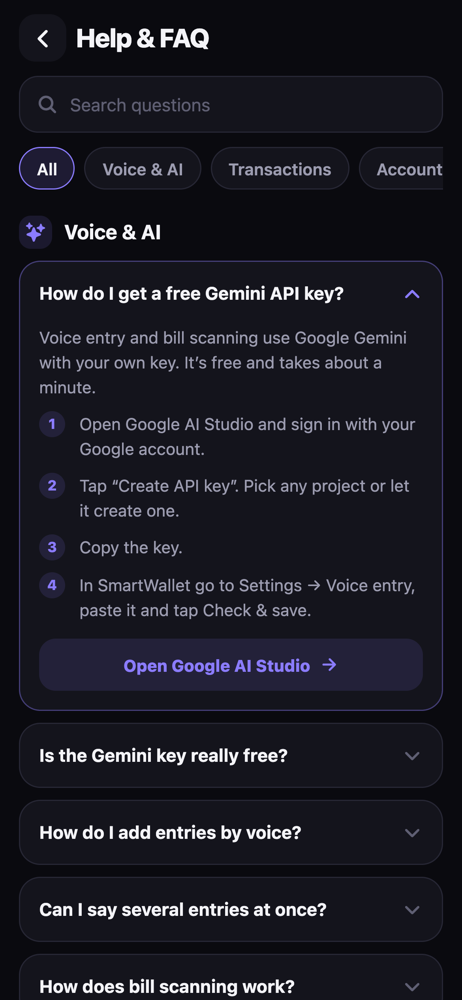
  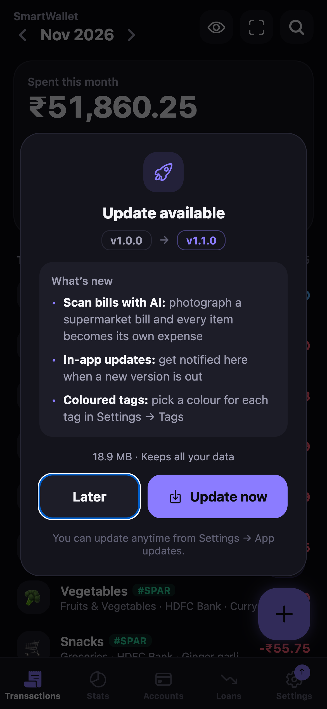
</p>

<sub>Screenshots use sample data.</sub>

## Set up voice and bill scanning

Voice entry and bill scanning use Google Gemini with **your own free API key**. Everything else works without it.

1. Open [Google AI Studio](https://aistudio.google.com/apikey) and sign in with your Google account.
2. Tap **Create API key** and copy it.
3. In SmartWallet go to **Settings → Voice entry**, paste the key and tap **Check & save**.

The free tier is plenty for personal use and needs no card. The key is stored encrypted on your phone and is never part of backups.

## Privacy

- All your data lives in one file **on your phone**. There's no account, no server and no analytics.
- Voice clips and bill photos go to Google Gemini **only when you use those features**, together with your account, category and tag names so it can match them. Balances and past transactions never leave your phone.
- Backups go only where you choose to save them.

## Updates

SmartWallet checks this page for new versions and shows a popup with what's new. Tap **Update now**, or update later from **Settings → App updates**. Your data stays as it is. Every version is also listed under [Releases](https://github.com/thekirankumarv/SmartWallet-releases/releases).

## FAQ

<details>
<summary><b>Is it really free?</b></summary>

Yes. No ads, no subscriptions, no in-app purchases. If you'd like to say thanks, there's a **Support the developer** option in Settings.
</details>

<details>
<summary><b>Why isn't it on the Play Store?</b></summary>

It's distributed here on GitHub, so Android asks once for permission to install it. In-app updates are downloaded from this page and their checksum is verified before installing.
</details>

<details>
<summary><b>How do I move to a new phone?</b></summary>

On the old phone: **Settings → Backup to Google Drive**. On the new phone: install SmartWallet, then **Settings → Restore backup** and pick the file. Add your Gemini key again, since keys aren't stored in backups.
</details>

<details>
<summary><b>Can I bring data from another app?</b></summary>

Yes. **Settings → Import CSV** reads any file with `Date`, `Account`, `Type` and `Amount` columns. Accounts and categories are matched by name or created, and duplicates are skipped.

```csv
Date,Time,Type,Account,To Account,Category,Subcategory,Note,Amount,Tags
2026-10-24,08:15,Expense,HDFC Bank,,Dairy,Milk,,56,"milk, swiggy instamart"
2026-10-01,,Income,HDFC Bank,,Salary,,,85000,
2026-10-05,,Transfer,HDFC Bank,Home Loan,,,,21500,
```
</details>

<details>
<summary><b>Does it work offline?</b></summary>

Everything except voice entry, bill scanning and update checks works with no internet at all.
</details>

<details>
<summary><b>Found a bug or have an idea?</b></summary>

Use **Settings → Send feedback** in the app, or open an [issue](https://github.com/thekirankumarv/SmartWallet-releases/issues).
</details>
